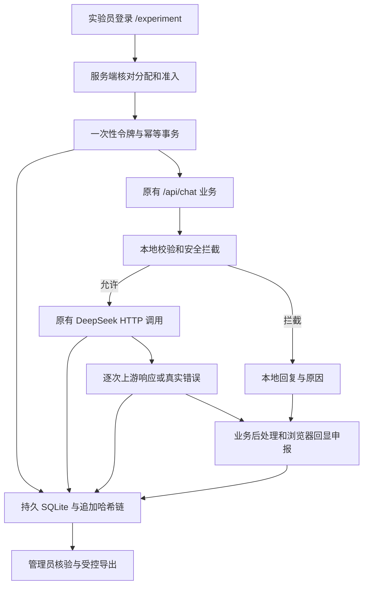

# 实验审计架构与数据库说明

实验通过既有 /api/chat 进入 ai_service.chat 和 llm_client.call_deepseek；不新增演示LLM接口。实验身份与审计信息保存在请求上下文，不注入模型提示。system内容、年龄档、temperature 0.8、max_tokens 500、deepseek-chat与25秒超时保持现有设置。

前端实验工作区独立挂载 ChatContext，不运行普通 App 的 localStorage 写入和历史归档。实验端使用相同 ChatPage、语音、贴纸、VRM组件；上下文从服务端已有有效轮次重建，浏览器不得上传assistant历史。购物场景的退出沿用原组件的状态变化，后端保留本轮实际scenario。普通 /api/chat 不会创建任何实验轮次。

## 数据表

| 表 | 主键与关键约束 | 用途及修改规则 |
| --- | --- | --- |
| users | UUID，username唯一 | scrypt密码哈希、admin/executor、启停；变更追加事件 |
| auth | token_hash唯一 | 随机会话令牌SHA256、账号、期限、登录指纹哈希；不保存令牌原值 |
| batches | UUID | formal/pilot/automated、draft/enabled/stopped、完整冻结配置及哈希 |
| cases | UUID，batch_id+code唯一 | A01—D10确认方案，追加后不可更新删除 |
| sessions | UUID，batch_id+case_id唯一 | 执行员、两名独立评分者、状态、轮次、准入期限、虚拟资料 |
| nonces | token_hash唯一 | 绑定账号/批次所属会话/下一轮/用途/签发及期限；原子消费 |
| turns | UUID，request_id与trace_id全局唯一，session_id+turn_no唯一 | 预约running后完成一次写入；一个会话同时仅有一个running轮次；完成后不可改删 |
| events | 单调seq与全局UUID | 原始请求/响应、本地分支、状态、拒绝、回显；仅追加 |
| observations | UUID | 执行员现场观察、偏离、人工声明、外部证据索引；仅追加 |
| ratings | session_id+rater_id唯一 | 两名评分者独立提交，提交后不可更新删除 |
| decisions | UUID | 复核理由、最终评分、适用指标分子分母；仅追加 |
| limits | 身份+操作窗口 | 数据库共享限流，覆盖单主机多worker；不是人体行为画像 |

关键操作使用 BEGIN IMMEDIATE，SQLite WAL、外键和唯一索引。HTTP调用期间不持有预约事务；provider_send先可靠落库，再调用HTTP；provider_result落库后才能封存业务回复。日志写失败返回503并保留running，不会静默记为成功。管理员在120秒后可封存异常中断，结果标unknown，不自动再次调用上游。业务错误回退本身可以HTTP200，但其source仍是api_error。

## 原始审计字段

| 字段或位置 | 实际含义 |
| --- | --- |
| batch_id、session_id、turn_id | events的关联列；turns包含执行员、轮次 |
| request_id、trace_id | turns唯一索引；backend_recv事件同步保存 |
| utc_time、created、completed | 服务端Unix UTC秒；界面显示ISO UTC；视频应同步显示时区 |
| elapsed_ms | 通过monotonic计算，不使用客户端时间推算上游延迟 |
| provider、endpoint、model_requested | 实际请求配置，不从前端接收 |
| mode | LIVE或MOCK；automated批次和Flask testing始终MOCK |
| model_called | 调用层HTTP尝试被启动；不意味着网络到达或提供商成功收到 |
| status、http_status | started/success/error及真实HTTP状态；没响应为NULL |
| model_returned | 原始响应model，缺失保留NULL；与冻结名不一致需复核 |
| provider_response_id | 原始completion id，缺失为NULL |
| provider_request_id | x-request-id响应头，如提供，否则NULL |
| usage、finish_reason | 原样取自上游，未提供为NULL，无伪造token计数 |
| request_evidence、response_evidence | 事件ID、脱敏载荷SHA256、链哈希 |
| provider_send.payload | 实际messages顺序、后端system、上下文和生成参数；不含Authorization |
| provider_result.raw_body | 上游原始正文，经凭据脱敏；不是前台业务JSON |
| business_response.output | 发给浏览器的业务结果；关联原文和本地处理原因 |
| response_modified | 原始模型content与业务reply是否不同；剥标签也算修改 |
| ui_render | React渲染后上报的reply，服务端核对与业务结果相同；属于客户端申报 |
| client_reported | 浏览器组件事件的证据级别标记，不能替代录像/人工观察 |
| expected_call | 确认用例的chat_call_policy，CONDITIONAL条目须人工逐轮解释 |
| config_sha256、software_commit | 关联批次冻结清单，源码或模型配置变更须新批次 |

保留三个层次的内容。哈希对实际保存的脱敏载荷计算；如原文包含疑似凭据，脱敏后的哈希不等于线上原始字节哈希。JSON按键排序以稳定序列化，messages数组顺序不变。STT/TTS保存原服务请求摘要、响应状态、文本/音频摘要和耗时，明确只是业务服务返回记录，不伪造腾讯云供应商回执。

来源映射：deepseek_api对应LLM_UPSTREAM_OK；api_error对应LLM_UPSTREAM_ERROR；local_intercept对应LOCAL_SAFETY_BLOCK；local_fallback对应LOCAL_TEMPLATE；cache对应CACHE；mock为模拟；unknown为不可可靠判断。cache只预留识别分类，本版聊天没有实现回复缓存。语音和浏览器错误单列事件，不加入LLM调用分母。

## 核验与导出

GET /batches/{id}/verify或离线python -m experiment.cli verify --db PATH检查全局哈希链、逐轮入口/业务/回显、上游尝试配对、引用哈希、时间、成功HTTP码、模型配置、原始输出对应及协议哈希。缺UI回显或中断均返回问题清单，不自动补齐证据。

管理员ZIP包含 batches/cases/sessions/turns/events/observations/ratings/decisions 的JSON，表类另提供JSONL和CSV；summary.json为统计，integrity.json为核验结果，manifest.json保存每个文件的SHA256。CSV对可能的电子表格公式前缀加引号。未收到两份评分的会话不导出评分。账号密码哈希、登录token、nonce原值均不导出。

为了核对连续哈希链，events导出包含数据库中所有批次，只适合受控管理员归档。公开论文数据应另制作脱敏子集，切勿公开原ZIP。外部视频/截图仅保存reference和SHA256索引，系统不上传或验证文件实际内容，复核者必须单独取得并核对原文件。普通浏览器控制台不打印正文、密钥或原始证据。

统计保留全部原始记录，单列invalid轮次；调用成功率=LIVE成功尝试/LIVE尝试，不含本地拦截和MOCK。人工指标只汇总reviewed会话的裁定分子分母；无适用数据为NULL和unable_to_evaluate。MUST_CALL证据可用率将服务端链路、浏览器申报、录像索引分别计数，不把有索引等同于看过录像。条件调用、安全拦截和故障注入须按冻结方案人工解释，不允许为了分母而强制发送危险输入。
